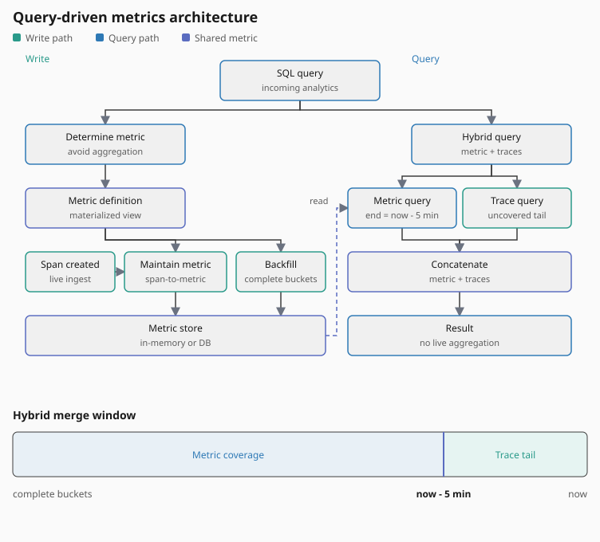

# Jorm Observability

Jorm Observability removes metrics without a performance penalty.

When people instrument a service, they struggle with what metrics to emit. Wide events alleviate this issue. But when you need to aggregate a large volume of data, it becomes unacceptably slow, for example, when you want to aggregate one week of data. Then the metrics are brought back.

Jorm Observability solves this awkward situation. It helps you maintain the aggregation result automatically — then you can query wide events/traces directly and the performance is like using metrics. It provides both flexibility and performance.

# How it works

Jorm Observability detects aggregation queries and maintains the aggregation result when it finds the query is slow. The next time that query runs, Jorm Observability answers it from the maintained result instead of doing heavy aggregation. Its architecture looks like the following:

Its state maintenance is like [Noria](https://github.com/mit-pdos/noria)/[Readyset](https://readyset.io/), but you don't have to create the view manually. ClickHouse supports materialized views, but it requires you to create the materialized view and you have to change your query.

If you can't bear the troubles of metrics creation and the slowness of aggregation on a query, Jorm Observability is the right choice — it handles all of those and works as you expected.

# Target Performance Improvement Compared with wide event/trace aggregation

| Use case | Improvement |
|----------|-------------|
| Ad-hoc analytics | 2x ~ 5x (tested) |
| Dashboard long window | 10x ~ 100x (estimated) |

# NOTICE
This is a POC project and everything is still underway.
