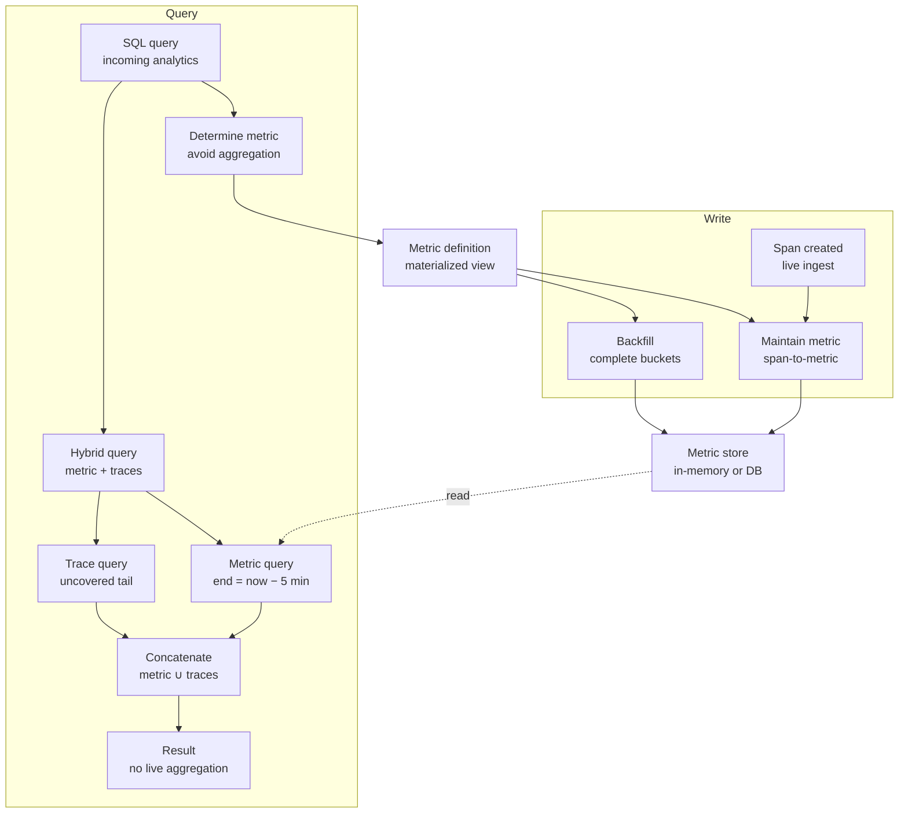

# Introduction

## Key Idea

Maintain metrics based on the query; use the metrics to speed up the query as it does not require aggregation.

## Query optimization

1. Maintain a metric (materialized view) based on the traces query
2. Use the metric (materialized view) to avoid aggregation for the query

## Architecture

Write path: a span is injected into the metric, and backfill fills complete buckets.

Query path: hybrid execution reads the metric through **now − 5 min**, queries traces for the tail and any gap, then concatenates the two.

### Hybrid merge window

Metric query ends at now − 5 minutes. The trace query covers the lag window and any backfill gap.

- **Live inject:** seeing a point at time *x* does not mean every earlier span has been injected. Each span updates metrics within 5 minutes.
- **Backfill:** once a metric bucket exists, it includes every span in that bucket range.

The split is safe because the 5-minute trace query is fast, and the metric side is already aggregated.

## Correctness and Concurrency
### Metric Generation
When we receive a SQL query, we determine what kind of metric (materialized view) can be used to avoid aggregation.

Then, when a span has been created, we maintain the metric. It is like the OTel span-to-metric connector[1], but requires us to figure out what metrics (materialized views) we need to maintain.

### Query
For a query, if it has a related metric, we query the metric. As the metric may not cover all existing spans (e.g. it has not backfilled all spans for a newly created metric), we concatenate two results: the metric result and the trace result.

For the metric query, the end time is current time − 5 minutes.

1. Because we create metrics for spans concurrently, even if we see a metric at time *x*, that does not mean all spans before *x* have triggered a metrics update. But we can guarantee that, at any time, a span's metrics are created within 5 minutes.
2. When we backfill data for a new metric, we can guarantee that once a metric data point has been created, it includes all spans' data in the bucket range.

This assumption is valid and useful — we can guarantee this, and a 5-minute trace query is fast.

[TODO] Provide formal verification of the merge query.

## Checking

1. [todo] Compare the trace query result with the materialized view query result after a new materialized view has been created
2. [todo] Use a live query to compare the two results occasionally

## Materialized View Maintenance

1. [todo] Memory-limited, in-memory materialized view for ad-hoc queries
2. [todo] Calculation-limited DB materialized view for long-lived queries

## Use Cases

1. Short ad-hoc query performance improvement — **2x ~ 5x** (tested)
2. Long-lived query in dashboard (e.g. 1 week request count) — **10x ~ 100x** (estimated, but achievable)
3. [todo] Log-based metrics — normally complex queries; materialized views help a lot

## AI Usage

1. [todo] Log-based metrics
2. [TBD] Determine whether a metric should be generated based on feedback

### Performance targets

| Use case | MV kind | Improvement |
|----------|---------|-------------|
| Ad-hoc analytics | In-memory (todo) | 2x ~ 5x (tested) |
| Dashboard long window | DB MV | 10x ~ 100x (estimated) |
| Log-based metrics (todo) | DB / AI-assisted | Large gain on complex queries |

### Links
1. https://github.com/open-telemetry/opentelemetry-collector-contrib/blob/main/connector/spanmetricsconnector/README.md
