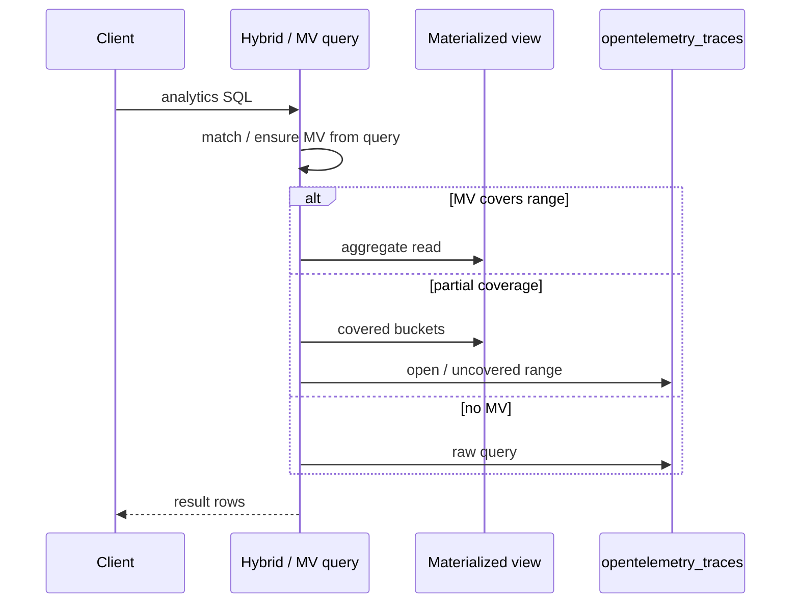

# Architecture

## Key Idea

Maintain materialized views based on query; use the materialized view for query optimization.

## Query optimization

1. Maintain materialized view based on traces query
2. When query, query on the materialized view

## Verification

1. [todo] Compare trace query result with materialized view query result after new materialized view has been created
2. [todo] Use live query to compare 2 results occasionally

## Materialized View Maintenance

1. [todo] Memory limited, in-memory materialized view for ad-hoc query
2. [todo] Calculation limited in DB materialized view for long-lived query

## Use Cases

1. Short ad-hoc query performance improvement — **2x ~ 5x** (tested)
2. Long-lived query in dashboard (e.g. 1 week request count) — **10x ~ 100x** (estimated, but achievable)
3. [todo] Log-based metrics — complex query normally; materialized view benefits much

## AI Usage

1. [todo] Log-based metrics
2. [TBD] Materialized view generation

### Read path (summary)

### Performance targets

| Use case | MV kind | Improvement |
|----------|---------|-------------|
| Ad-hoc analytics | In-memory (todo) | 2x ~ 5x (tested) |
| Dashboard long window | DB MV | 10x ~ 100x (estimated) |
| Log-based metrics (todo) | DB / AI-assisted | Large gain on complex queries |
